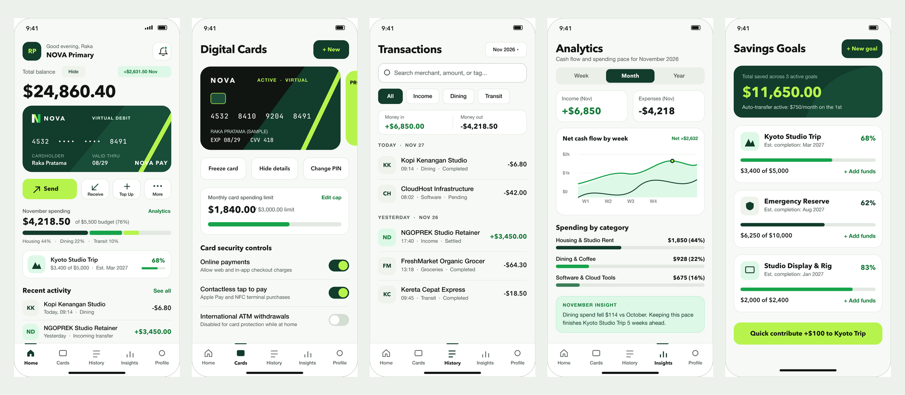
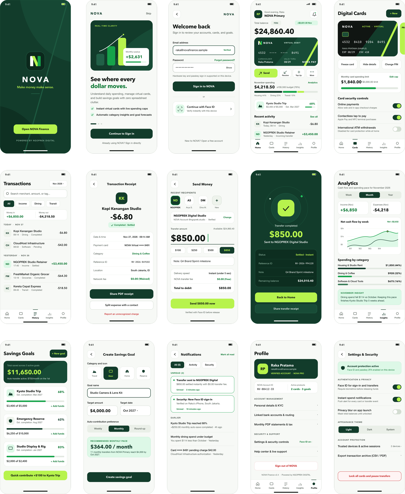
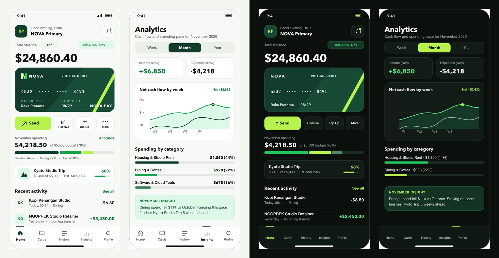
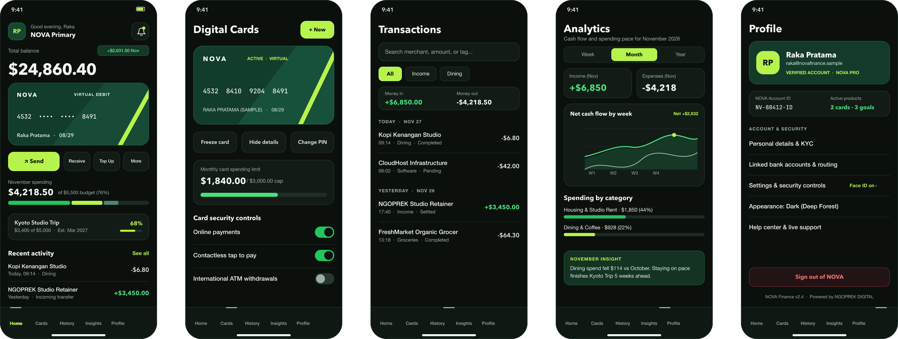
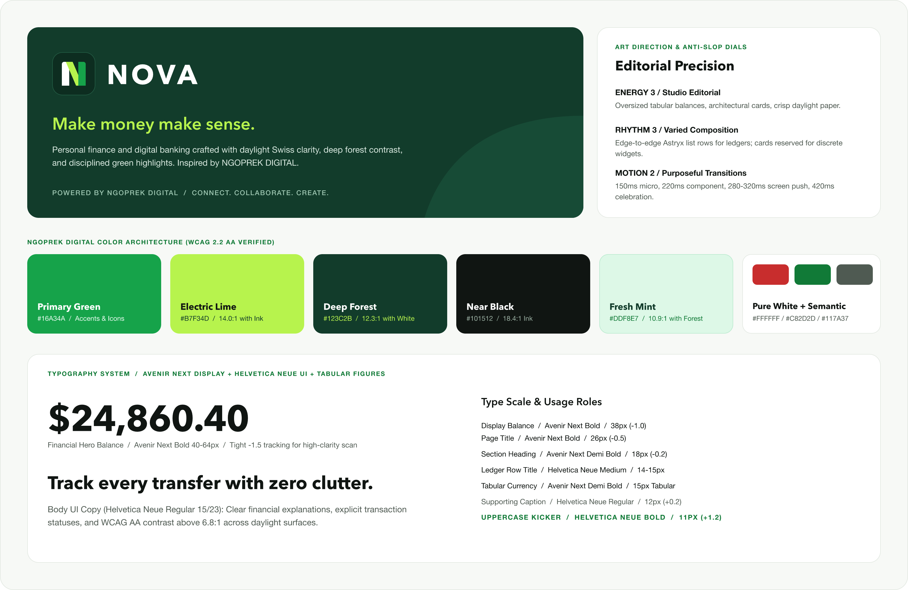
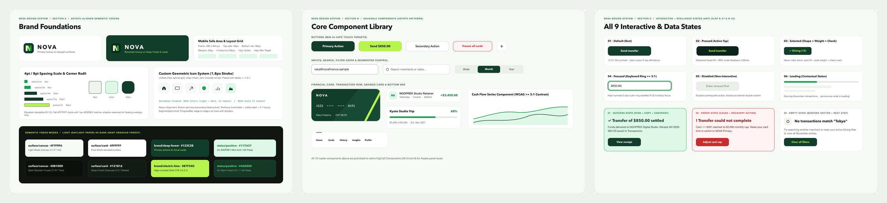
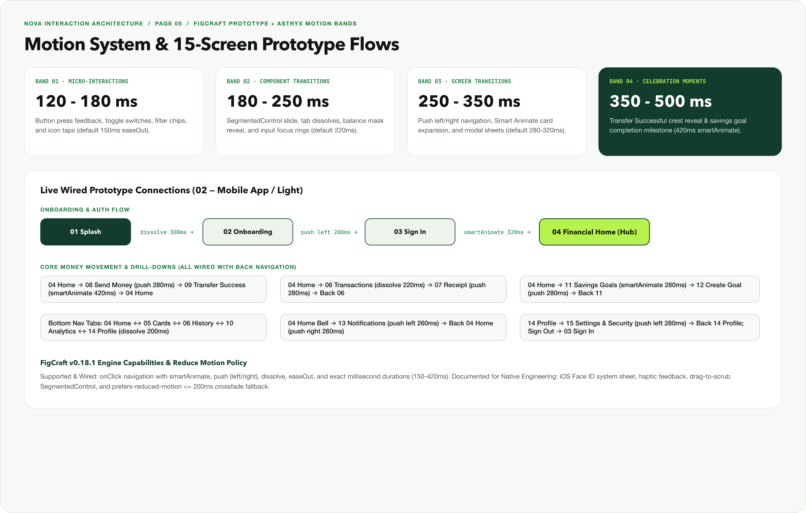
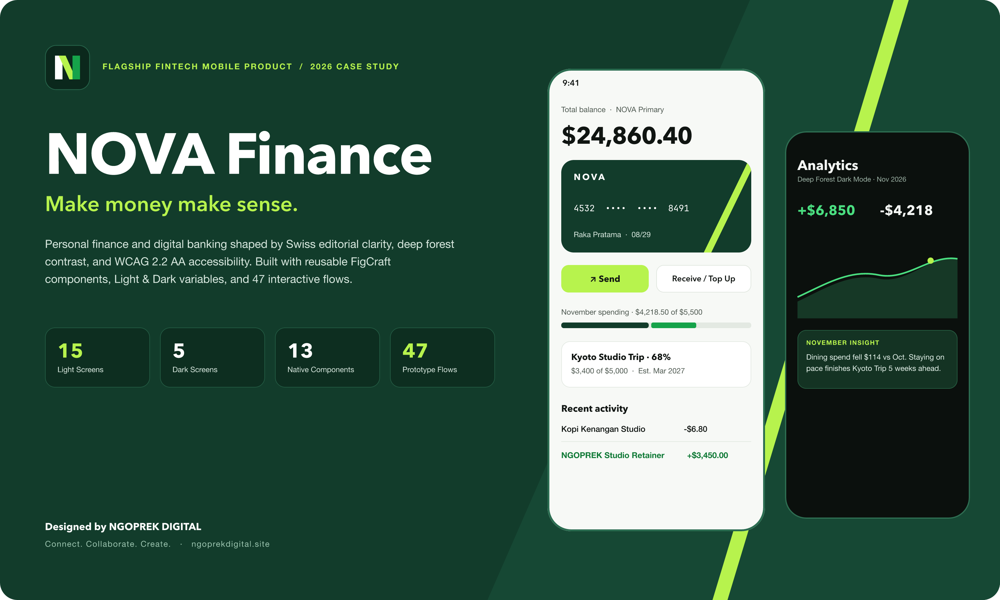
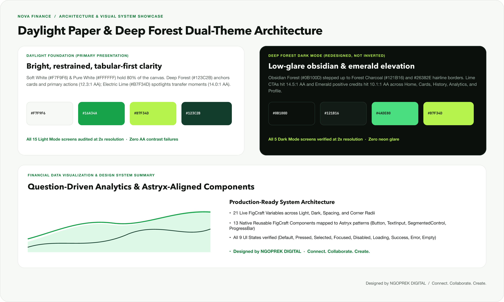

<div align="center">

<picture>
  <source media="(prefers-reduced-motion: reduce)" srcset="./assets/github/nova-hero-banner.png">
  
</picture>

<br>

**Make money make sense.**

A personal finance and digital banking mobile app concept featuring an editable FigCraft design system, 20 mobile screens across Light and Dark themes, and 47 interactive prototype flows.

*Product Design Concept & Interactive Prototype · Designed by [NGOPREK DIGITAL](https://www.ngoprekdigital.site/)*

[Product Showcase](#product-showcase) · [Light & Dark](#light-and-dark-experience) · [Design System](#design-system) · [Interactive Prototype](#interactive-prototype) · [Workflow](#design-engineering-workflow) · [Getting Started](#getting-started) · [Roadmap](#development-roadmap)

</div>

---

> **Project Status & Transparency**
>
> NOVA Finance is a **Product Design Concept and Interactive Prototype** built inside FigCraft Desktop. It is **not** a production banking application. All balances, card numbers, merchant names, and transaction entries shown in previews are fictional sample data. Live banking rails, payment gateways, production authentication, backend services, and Flutter implementation are listed in the [Development Roadmap](#development-roadmap) as planned future work. This concept was produced with an AI-assisted design engineering workflow (Google Antigravity + FigCraft MCP) under human creative direction.

---

## Product Overview

NOVA Finance helps individuals track daily spending, control virtual debit cards, review clear transaction ledgers, and reach savings goals without cluttered dashboards.

Inspired by the editorial restraint and WCAG 2.2 AA discipline of [NGOPREK DIGITAL](https://www.ngoprekdigital.site/), the visual direction pairs daylight paper surfaces (`#F7F9F6` and `#FFFFFF`) with Deep Forest (`#123C2B`) structural anchors, Near Black (`#101512`) typography, and disciplined Electric Lime (`#B7F34D`) and Primary Green (`#16A34A`) highlights.

| Deliverable | Verified Count | Scope |
| :--- | :--- | :--- |
| Editable FigCraft Source | `1` file (`148 KB`, `1,339` nodes) | `design/NOVA-Finance.figcraft` (`6` pages, `0` missing fonts) |
| Light-Mode Mobile Screens | `15` screens (`390 x 844 px`) | Splash, Onboarding, Auth, Home, Cards, History, Receipt, Send, Success, Analytics, Goals, New Goal, Notifications, Profile, Settings |
| Dark-Mode Mobile Screens | `5` screens (`390 x 844 px`) | Financial Home, Digital Cards, Transactions, Analytics, Profile |
| Native FigCraft Components | `13` components | Buttons, Inputs, Search, SegmentedControl, Virtual Card, Ledger Row, Savings Card, Bottom Nav, Cash Flow Chart |
| Native FigCraft Variables | `21` variables | `12` Light/Dark color tokens + `9` spacing & corner-radius scale tokens |
| Interactive Prototype Flows | `47` wired transitions | `onClick` `smartAnimate`, `push`, and `dissolve` connections (`200-420 ms`) |

Full scope and user scenarios live in [docs/PRODUCT_OVERVIEW.md](./docs/PRODUCT_OVERVIEW.md).

---

## Product Showcase

The flagship five-screen core highlights the day-to-day financial flow: **Financial Home**, **Digital Cards**, **Transaction History**, **Financial Analytics**, and **Savings Goals**.

<p align="center">
  
</p>

- **Financial Home (`04`)**: Open daylight balance hero (`$24,860.40`), deep-forest virtual debit card, asymmetric primary `Send` action in Electric Lime (`14.01:1` contrast), segmented monthly budget bar, savings preview, and edge-to-edge ledger rows.
- **Digital Cards (`05`)**: Layered virtual debit card with fictional card controls (`4532 •••• •••• 8491`), monthly spending cap progress bar, and instant toggles for online, contactless, and international ATM protection.
- **Transaction History (`06`) & Receipt (`07`)**: Search bar, date filter, category chips, inflow/outflow summary, grouped edge-to-edge rows, and itemized transaction receipts with `Reference ID` and waived fee transparency.
- **Financial Analytics (`10`)**: Question-driven cash flow area chart, weekly net trend spline, proportional category bars, and concrete monthly pace insight.
- **Savings Goals (`11`) & Create Goal (`12`)**: Consolidated goal balance banner, custom vector category emblems, target dates, and auto-contribution calculator.

<details>
<summary><strong>View All 15 Light-Mode Screens Overview</strong></summary>
<br>
<p align="center">
  
</p>
</details>

---

## Light and Dark Experience

Dark mode is redesigned around **Obsidian Forest (`#0B100D`)** and **Forest Charcoal (`#121B16`)** elevation layers rather than inverting light colors. Text contrast reaches `17.78:1` for primary ink (`#F4F7F4`), `7.65:1` for secondary metadata (`#9BB0A3`), `14.57:1` for Electric Lime actions, and `10.09:1` for positive emerald inflow figures (`#4ADE80`).

<p align="center">
  
</p>

<details>
<summary><strong>View All 5 Redesigned Dark-Mode Screens</strong></summary>
<br>
<p align="center">
  
</p>
</details>

---

## Brand Identity & Design System

The NOVA Design System lives on dedicated pages inside `design/NOVA-Finance.figcraft` (`01 — Brand Direction` and `04 — Design System`) and is documented in [docs/DESIGN_SYSTEM.md](./docs/DESIGN_SYSTEM.md).

<p align="center">
  
</p>

### Foundations, Native Components, and All 9 States

<p align="center">
  
</p>

| Token Role | Light Mode | Dark Mode | Verified Contrast Pair |
| :--- | :--- | :--- | :--- |
| `surface/canvas` | `#F7F9F6` | `#0B100D` | `17.43:1` (Light) / `17.78:1` (Dark) with primary ink |
| `surface/card` | `#FFFFFF` | `#121B16` | `7.20:1` (Light) / `7.65:1` (Dark) with secondary ink |
| `brand/deep-forest` | `#123C2B` | `#164733` | `12.30:1` with `#FFFFFF` / `9.34:1` with `#B7F34D` |
| `brand/electric-lime` | `#B7F34D` | `#B7F34D` | `14.01:1` with `#101512` / `14.57:1` with `#0B100D` |
| `brand/primary-green` | `#16A34A` | `#22C55E` | Accents, vector fills, and chart strokes (`#117A37` `5.44:1` for small green text on white) |
| `brand/fresh-mint` | `#DDF8E7` | `#163826` | `10.93:1` with `#123C2B` (Light) / `10.09:1` with `#4ADE80` (Dark) |
| `status/error` | `#C82D2D` | `#F87171` | `5.43:1` on `#FFFFFF` / `6.36:1` on `#121B16` (always paired with text + icon) |

Full component inventory, variable listings, and state rules: [docs/DESIGN_SYSTEM.md](./docs/DESIGN_SYSTEM.md) and [docs/ACCESSIBILITY.md](./docs/ACCESSIBILITY.md).

---

## Interactive Prototype

All 15 Light Mode screens are wired with **47 native FigCraft prototype interactions** using `onClick` navigation across four defined motion bands (`120-180 ms` micro, `180-250 ms` component, `250-350 ms` screen push/smartAnimate, `350-500 ms` transfer celebration).

<p align="center">
  
</p>

Key wired journeys in `design/NOVA-Finance.figcraft`:

1. **Entry & Authentication**: `01 Splash` (`dissolve 300ms`) -> `02 Onboarding` (`push left 280ms`) -> `03 Sign In` (`smartAnimate 320ms`) -> `04 Financial Home`.
2. **Primary Tab Navigation**: `04 Home` <-> `05 Cards` <-> `06 History` <-> `10 Analytics` <-> `14 Profile` (`dissolve 200ms`).
3. **Money Transfer & Celebration**: `04 Home` (`Send`) -> `08 Send Money` (`push left 280ms`) -> `09 Transfer Successful` (`smartAnimate 420ms`) -> `04 Home` or `07 Receipt`.
4. **Transactions, Goals, Alerts & Security**: `06 History` -> `07 Receipt` (`push 280ms`), `04 Home` -> `11 Goals` -> `12 Create Goal`, `04 Home` -> `13 Notifications`, and `14 Profile` -> `15 Settings & Security`, each with wired back navigation.

*Note on recordings*: No screen-recorded video or fabricated animation GIF is included; open `design/NOVA-Finance.figcraft` in FigCraft Desktop Present mode to click through all 47 live transitions directly. Supported engine transitions and engineering handoff notes are documented in [docs/PROTOTYPE.md](./docs/PROTOTYPE.md).

---

## Design Engineering Workflow

NOVA Finance was designed directly on the live FigCraft Desktop canvas through an integrated, quality-gated workflow documented in [docs/DESIGN_WORKFLOW.md](./docs/DESIGN_WORKFLOW.md):

- **Google Antigravity + FigCraft MCP Live Mode**: Connected to FigCraft Desktop over local loopback (`127.0.0.1:7979`) with live step-by-step layer streaming (`85 ms/step`), automatic frame selection, and viewport framing (`view.zoomSelection`, `view.zoomFit`).
- **Astryx Design System Guidance**: Queried Meta's `astryx` CLI for accessible layout and component principles (edge-to-edge ledger rows with dividers instead of wrapping every list item in a card, semantic color/spacing tokens, controlled form fields with visible labels, and `>= 3:1` keyboard focus rings). Visual styling was customized entirely to NOVA Finance and NGOPREK DIGITAL rather than copying Astryx's default theme.
- **Anti-Slop Quality Control (Mode 1: DURING)**: Enforced `ENERGY 3 / RHYTHM 3 / MOTION 2` dials continuously during creation, verified WCAG 2.2 AA ratios mathematically across all 19 color pairings before drawing (catching white-on-`#16A34A` at `3.30:1` and shifting normal-text CTAs to Deep Forest `#123C2B` at `12.30:1` and Electric Lime `#B7F34D` with Near Black ink at `14.01:1`), and audited exported PNGs at 2x resolution to fix typography wrapping, card label placement, and amount alignment before final export.

---

## Project Architecture

```text
nova-finance/
├── README.md                              # Portfolio overview and visual showcase
├── LICENSE                                # Copyright notice & third-party attributions
├── .gitignore                             # Excludes OS, secret, cache, and local MCP files
├── design/
│   └── NOVA-Finance.figcraft              # Editable 6-page FigCraft source (1,339 nodes)
├── assets/
│   ├── branding/                          # Original NOVA SVG marks & Brand Direction board
│   ├── icons/                             # 6 custom geometric 1.8px SVG icons
│   ├── illustrations/                     # Editable SVG illustrations (growth, card, crest)
│   └── github/                            # Animated SVG hero, 1280x640 social preview, strips
├── previews/
│   ├── light-mode/                        # 15 light-mode screens (2x) + 15-screen overview
│   ├── dark-mode/                         # 5 dark-mode screens (2x) + 5-screen overview
│   ├── design-system/                     # Foundations, Core Components, and 9 UI States (2x)
│   ├── prototype/                         # Motion timing & prototype flow topology (2x)
│   └── showcase/                          # Portfolio presentation & 4:5 social teaser (2x)
└── docs/
    ├── PRODUCT_OVERVIEW.md                # Concept goals, personas, and screen inventory
    ├── DESIGN_SYSTEM.md                   # Verified tokens, typography, components, and states
    ├── DESIGN_WORKFLOW.md                 # Live FigCraft MCP, Astryx, and Anti-Slop process
    ├── PROTOTYPE.md                       # All 47 wired flows and engine capabilities
    ├── ACCESSIBILITY.md                   # WCAG 2.2 AA contrast audit and UX checks
    └── ROADMAP.md                         # Planned Flutter and backend engineering roadmap
```

---

## Getting Started

To inspect the editable layers, variables, components, and clickable prototype locally:

1. Install **FigCraft Desktop** (tested with FigCraft `v0.18.1`).
2. Clone this repository or download the source file directly:

   ```sh
   git clone https://github.com/dandisetiawanco/nova-finance.git
   ```

3. Open the editable project file in FigCraft Desktop:

   ```text
   design/NOVA-Finance.figcraft
   ```

4. Navigate across the six pages (`01 — Brand Direction` through `06 — Product Showcase`), inspect variables in the **Variables** panel, inspect the 13 reusable components in **Assets**, or open **Present** on `02 — Mobile App / Light` to test all 47 prototype transitions.

*Typography note*: `design/NOVA-Finance.figcraft` references `Avenir Next`, `Helvetica Neue`, and `JetBrainsMonoNL Nerd Font`. On non-macOS systems without those fonts installed, FigCraft will display its missing-font substitution dialog.

---

## Development Roadmap

The following engineering milestones are **planned future phases** and are **not implemented** in this design repository:

- **Planned: Flutter Mobile Application** (`390 x 844` responsive adaptation, Riverpod/Bloc state, theme switching mapped to NOVA Light/Dark tokens)
- **Planned: Backend API & Ledger Service** (double-entry transaction API, webhook ingestion, idempotent transfer orchestration)
- **Planned: Production Authentication & Biometrics** (passkey/WebAuthn, iOS Face ID / Android BiometricPrompt, device session management)
- **Planned: Transaction & Card Controls** (virtual card issuer integration, spend cap enforcement, real-time filtering, PDF receipt generation)
- **Planned: Financial Analytics Engine** (real cash-flow aggregation, merchant categorization, monthly budget pace tracking)
- **Planned: Savings Goals Automation** (scheduled transfers, round-up rules, milestone completion projections)
- **Planned: Notification & Security Pipeline** (push alerts, anomaly detection, emergency card freeze)

Detailed milestone sequencing is documented in [docs/ROADMAP.md](./docs/ROADMAP.md).

---

## Portfolio Presentation Preview

<details>
<summary><strong>View Full Product Showcase Boards</strong></summary>
<br>
<p align="center">
  
</p>
<p align="center">
  
</p>
</details>

---

## Credits

Designed and produced as a personal finance product design concept by **NGOPREK DIGITAL**.

- **GitHub**: [github.com/dandisetiawanco](https://github.com/dandisetiawanco)
- **Personal Website**: [dandisetiawan.id](https://www.dandisetiawan.id/)
- **NGOPREK DIGITAL**: [ngoprekdigital.site](https://www.ngoprekdigital.site/)
- **Instagram**: [@ngoprekdigital](https://www.instagram.com/ngoprekdigital/)

*Connect. Collaborate. Create.*
